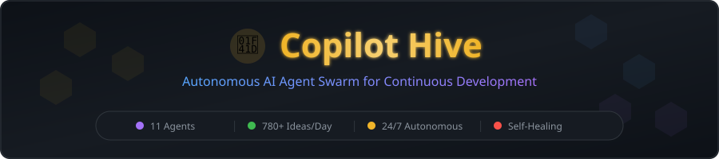
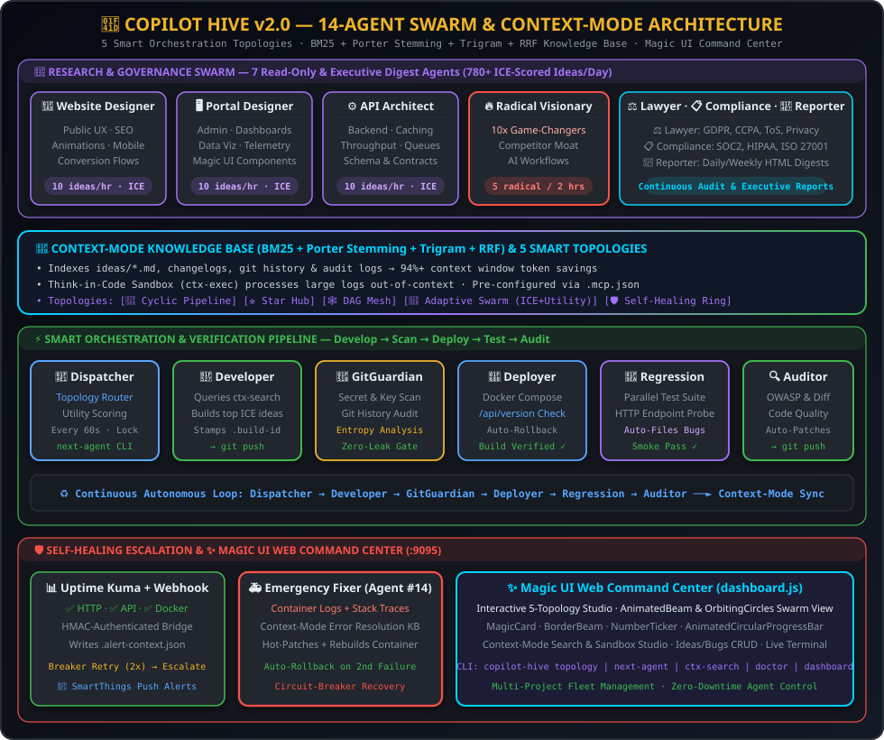
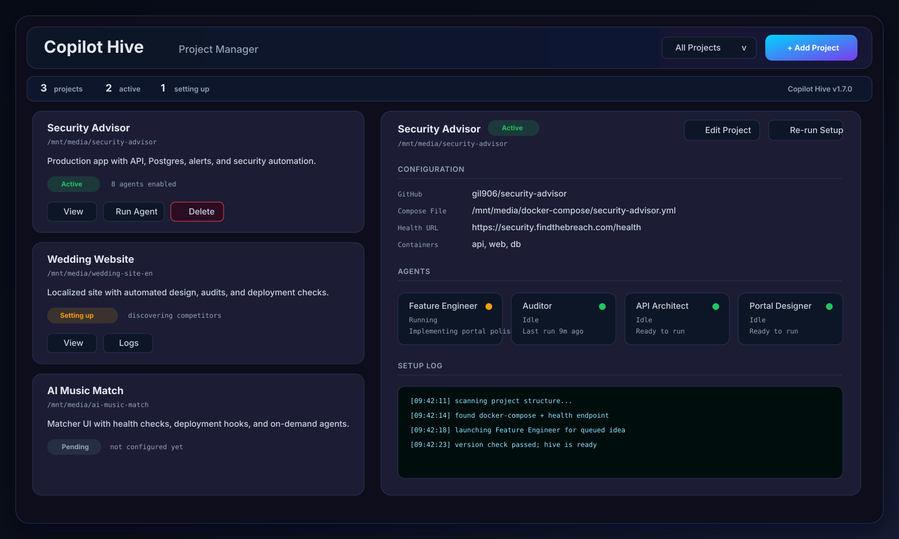
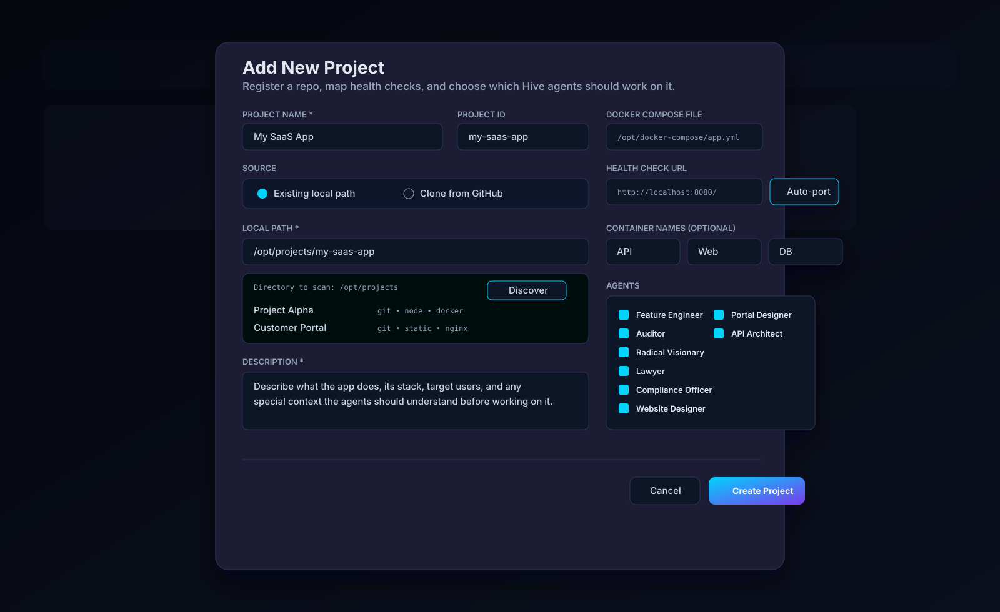
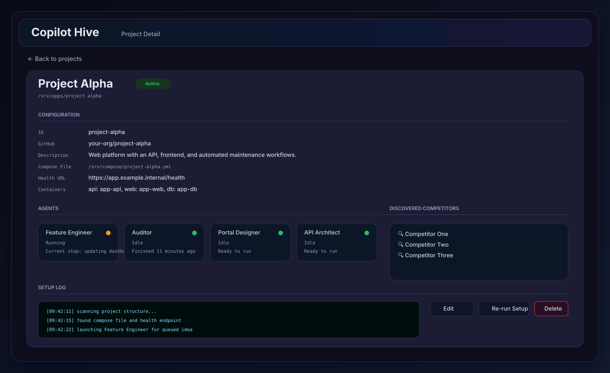
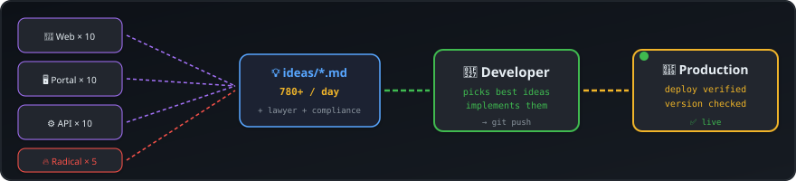
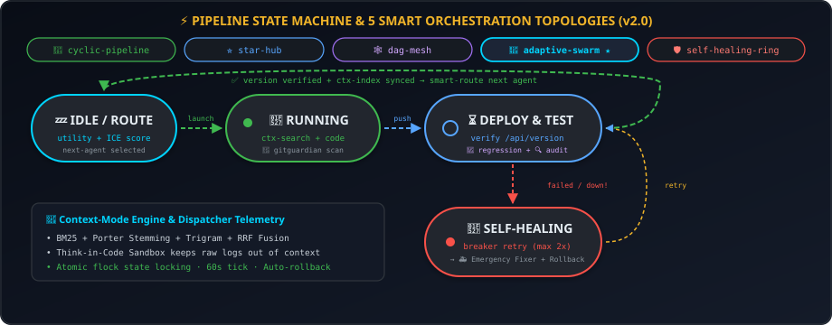
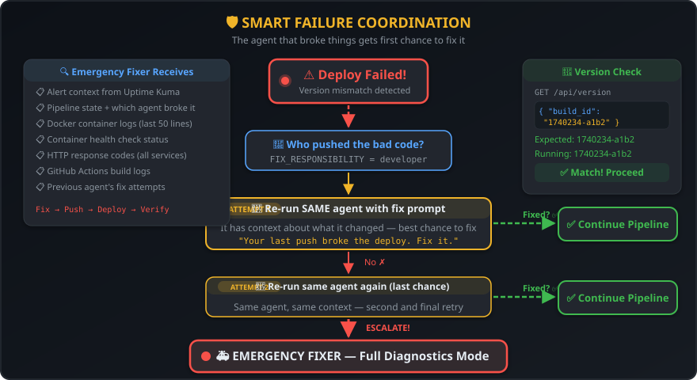

<div align="center">

<picture>
  <source media="(prefers-color-scheme: dark)" srcset="assets/banner.svg">
  <source media="(prefers-color-scheme: light)" srcset="assets/banner.svg">
  
</picture>

<br/><br/>

[](#-the-hive---14-autonomous-agents)
[](#-5-smart-orchestration-topologies)
[](#-context-mode-knowledge-base--sandbox)
[](#-magic-ui-web-command-center)
[](#-version-verification)
[](#-supported-platforms)

<br/>

*"What if your entire engineering team was AI — and never slept?"*

**Copilot Hive v2.0** is an open-source autonomous swarm framework powered by **14 specialized GitHub Copilot CLI agents**, **5 smart orchestration topologies** (including Multi-Factor Utility Scoring & ICE prioritization), a built-in **[Context-Mode](https://github.com/mksglu/context-mode) BM25/Trigram/RRF Knowledge Base & Think-in-Code Sandbox**, and a **Magic UI Web Command Center**. Agents research ideas, implement features, scan secrets, run regression tests, audit code, deploy changes, and self-heal failures — 24/7 without human intervention.

[Architecture](#-architecture) · [5 Topologies](#-5-smart-orchestration-topologies) · [Context-Mode](#-context-mode-knowledge-base--sandbox) · [Magic UI](#-magic-ui-web-command-center) · [14 Agents](#-the-hive---14-autonomous-agents) · [CLI v2.0](#-cli-v20--programmatic-sdk) · [Get Started](#-getting-started)

</div>

---

## 🏗️ Architecture

<div align="center">

</div>

<br/>

Four coordinated layers operate continuously:

| Layer | Agents & Engines | Purpose |
|:------|:-----------------|:--------|
| 🔬 **Research & Governance** | 7 read-only & digest agents | Generate 780+ ICE-scored ideas/day + legal/compliance/executive reports |
| 🧠 **Intelligence & Context-Mode** | `hive-engine.js` + `context-mode.js` | 5 orchestration topologies, utility scoring, BM25+Trigram+RRF retrieval & sandbox |
| ⚡ **Execution & Verification** | Dispatcher, Developer, GitGuardian, Deployer, Regression, Auditor | Implement → Secret Scan → Deploy → Smoke Test → Security Audit → Loop |
| 🛡️ **Self-Healing & Command Center** | Emergency Fixer + Uptime Kuma + Magic UI | Circuit-breaker auto-recovery, rollback, push alerts, and real-time web studio |

---

## 🕸️ 5 Smart Orchestration Topologies

Copilot Hive v2.0 replaces rigid single-loop scheduling with **5 selectable orchestration topologies** managed by `lib/hive-engine.js` (`copilot-hive topology [project-id] --set <mode>`):

| Topology | ID | How It Routes Agents | Best For |
|:---------|:---|:---------------------|:---------|
| 🔄 **Cyclic Pipeline** | `cyclic-pipeline` | Deterministic ring: `Developer → GitGuardian → Deployer → Regression → Auditor` | Steady, predictable continuous delivery |
| ⭐ **Star Hub** | `star-hub` | Central `Dispatcher` hub coordinates every specialist spoke with strict health checks between hops | High-governance apps requiring hub verification |
| 🕸️ **DAG Dependency Mesh** | `dag-mesh` | Parallel **Fan-Out** research & verification stages feeding **Fan-In** synthesis and deployment gates | Maximum throughput on multi-core hosts |
| 🧠 **Adaptive Swarm** *(Default)* | `adaptive-swarm` | Dynamic routing via **Multi-Factor Agent Utility Scoring** and **ICE Idea Prioritization** | Autonomous self-optimizing product velocity |
| 🛡️ **Self-Healing Ring** | `self-healing-ring` | Circuit-breaker ring that isolates broken deploys, retries the breaker agent (2x), and escalates to `Emergency Fixer` | Mission-critical 99.99% uptime services |

### Multi-Factor Utility Scoring & ICE Prioritization

In `adaptive-swarm` mode, the Hive Engine computes a real-time utility score $U(a) \in [0, 1]$ for each agent:

$$U(a) = w_1 \cdot \text{Urgency} + w_2 \cdot \text{Staleness} + w_3 \cdot \text{ICE}_{\text{backlog}} + w_4 \cdot \text{BugPressure} + w_5 \cdot \text{HealthPenalty}$$

Every research idea in `ideas/*.md` and `ideas/admin_ideas.json` is ranked by its **ICE score** ($\text{Impact} \times \text{Confidence} \times \text{Ease}$) so the Developer agent always implements the highest-leverage improvements first.

---

## 🧠 Context-Mode Knowledge Base & Sandbox

Copilot Hive v2.0 integrates **[Context-Mode](https://github.com/mksglu/context-mode)** both via MCP (`.mcp.json` pre-configured with `npx -y context-mode`) and natively via `lib/context-mode.js` so raw logs and massive markdown files never bloat agent context windows:

- **Hybrid Multi-Strategy Search (`ctx-search`)**: Combines **Okapi BM25**, **Porter Stemming**, **3-gram Trigram Substring Matching**, and **Reciprocal Rank Fusion (RRF)** with proximity boosting to retrieve only the exact 300-byte windows an agent needs (achieving **90–96% context token savings**).
- **Automatic Swarm Indexing (`ctx-index`)**: Automatically indexes `ideas/*.md`, `changelogs/`, `bugs.json`, and `implemented.log` with SHA-256 content hashes for instant staleness detection.
- **Think-in-Code Sandbox (`ctx-exec`)**: Executes JavaScript, Python, or Shell analysis over multi-megabyte logs inside an isolated subprocess (`FILE_CONTENT`), returning only derived summaries to the agent.
- **Live Savings Telemetry (`ctx-stats`)**: Tracks raw bytes processed vs. context bytes emitted, savings ratios, and estimated tokens saved per project.

---

## ✨ Magic UI Web Command Center

> The **Copilot Hive Command Center** (`dashboard.js`, default `:9095`) is built with the **Magic UI** dark-mode design system — featuring interactive topology visualization, real-time agent telemetry, and a built-in Context-Mode studio.

### Key Magic UI Components & Studios

- **`MagicCard` & `BorderBeam`**: Spotlight-tracking glassmorphism project cards with animated gradient border beams for active agents.
- **`AnimatedBeam` & `OrbitingCircles` Topology Visualizer**: Interactive 5-mode SVG topology studio showing live energy beams flowing between the 14 agents.
- **`NumberTicker` & `AnimatedCircularProgressBar`**: Spring-animated counters for ideas/day, context token savings, and swarm health gauges.
- **`ShimmerButton`, `HyperText`, `Particles` & `FlickeringGrid`**: High-contrast cybernetic controls and ambient neural backdrop.
- **Interactive `Terminal` & Context-Mode Studio**: Stream live agent logs, run BM25+RRF searches, execute Think-in-Code sandbox snippets, and manage project ideas/bugs CRUD directly from the browser.

### 🧭 Fleet Overview

<div align="center">

</div>

<br/>

From one screen you can wire up a repo, choose which agents and topology should work on it, and watch the hive operate in real time.

### 🚀 Add Project Modal

The setup flow lets you register a local app or clone from GitHub, map health checks and containers, and choose exactly which Hive agents should be enabled for that project.

<div align="center">

</div>

<br/>

### 🔎 Project Detail, Agents, and Logs

Each project gets its own control surface with configuration, per-agent run buttons, competitor discovery, and a live setup log for troubleshooting.

<div align="center">

</div>

---

## 🐝 The Hive — 14 Autonomous Agents

### 📡 Orchestrator & Pipeline Agents

| | Agent | Script / Prompt | What It Does | Trigger |
|:--|:------|:----------------|:-------------|:--------|
| 📡 | **Dispatcher** | `copilot-dispatcher.sh` · `dispatcher.md` | Orchestrates the 5 smart topologies, lockfiles, `/api/version` verification & retries | Every 60s |
| 🔧 | **Developer** | `copilot-improve.sh` · `developer.md` | Queries Context-Mode & idea files, implements top ICE features, stamps `.build-id` & pushes | Pipeline / Swarm |
| 🔍 | **Auditor** | `copilot-audit.sh` · `auditor.md` | Reviews new commits for OWASP vulnerabilities, bugs & code quality; pushes fixes | Post-Deploy |
| 🚑 | **Emergency Fixer** | `copilot-emergencyfixer.sh` · `emergency-fixer.md` | Analyzes Docker logs + HTTP diagnostics, applies hotfixes or triggers git rollback | On failure escalation |

### 🧪 Verification & Security Agents

| | Agent | Script / Prompt | What It Does | Trigger |
|:--|:------|:----------------|:-------------|:--------|
| 🚀 | **Deployer** | `copilot-deployer.sh` · `deployer.md` | Rebuilds Docker containers, verifies health & `/api/version`, auto-rolls back on failure | On git push / manual |
| 🔐 | **GitGuardian** | `copilot-gitguardian.sh` · `gitguardian.md` | Scans working tree & git history for leaked secrets, API keys, and high-entropy tokens | Pre/Post-Deploy |
| 🧪 | **Regression Test** | `copilot-regressiontest.sh` · `regressiontest.md` | Runs parallel unit, integration, and HTTP smoke suites; files structured bugs on failure | Post-Deploy |

### 🔬 Research & Governance Agents

> Read-only — enforced via `--deny-tool` and `:ro` directory mounts. They analyze the codebase and competitors, then index structured idea documents into `ideas/` and Context-Mode.

| | Agent | Script / Prompt | Focus Area | Output | Schedule |
|:--|:------|:----------------|:-----------|:-------|:---------|
| 🎨 | **Website Designer** | `copilot-designer-web.sh` · `website-designer.md` | Public site UX, animations, landing pages, mobile, conversions | **10 ideas** | ⏱️ Every hour |
| 🖥️ | **Portal Designer** | `copilot-designer-portal.sh` · `portal-designer.md` | Dashboard, admin panel, charts, data viz, user settings | **10 ideas** | ⏱️ Every hour |
| ⚙️ | **API Architect** | `copilot-architect-api.sh` · `api-architect.md` | API design, scanners, orchestration, caching, throughput | **10 ideas** | ⏱️ Every hour |
| 🔥 | **Radical Visionary** | `copilot-radical.sh` · `radical-visionary.md` | 10x game-changers — competitor analysis, AI disruption | **5 transformative** | ⏱️ Every 2h |
| ⚖️ | **Lawyer** | `copilot-lawyer.sh` · `lawyer.md` | Privacy policies, ToS, GDPR/CCPA legal compliance | **5 ideas** | ⏱️ Every 2h |
| 📋 | **Compliance** | `copilot-compliance.sh` · `compliance.md` | SOC2, PCI-DSS, HIPAA, ISO 27001 readiness controls | **5 ideas** | ⏱️ Every 2h |
| 📧 | **Reporter** | `copilot-reporter.sh` · `reporter.md` | Sends HTML executive email summaries of swarm velocity & health | Digest | Daily + Weekly |

---

## 💡 Idea Flow

<div align="center">

</div>

<br/>

Research agents write structured markdown files to `ideas/`. The Developer reads **all 6 files** and picks the highest-impact ideas to implement:

```
ideas/web_design_latest.md    ─┐
ideas/portal_design_latest.md  │
ideas/api_architect_latest.md  ├──▶  🔧 Developer picks best ideas
ideas/radical_latest.md        │     implements → pushes → deploys
ideas/lawyer_latest.md         │
ideas/compliance_latest.md    ─┘
```

<table>
<tr><td align="center"><strong>Per Hour</strong></td><td>30 specialist ideas (10 web + 10 portal + 10 api)</td></tr>
<tr><td align="center"><strong>Per 2 Hours</strong></td><td>+ 15 strategic ideas (5 radical + 5 lawyer + 5 compliance)</td></tr>
<tr><td align="center"><strong>Per Day</strong></td><td><strong>~780 total ideas</strong> feeding the Developer agent</td></tr>
</table>

---

## ⚡ Event-Driven Pipeline

<div align="center">

</div>

<br/>

The **Dispatcher** (`copilot-dispatcher.sh`) runs **every 60 seconds** via cron and orchestrates the continuous Developer ↔ Auditor loop:

| State | What's Happening |
|:------|:----------------|
| 💤 **Idle** | Ready to launch next agent in the chain |
| 🔧 **Running** | Agent is actively working (PID tracked, monitored) |
| ⏳ **Deploy** | Code pushed — waiting for GitHub Actions + Docker deploy + version verification |
| 🔧 **Fixing** | Deploy failed — re-running the agent that broke it (2 retries before 🚑 escalation) |

### What a Cycle Looks Like

```
07:01  📡 Dispatcher → launches Developer
07:35  🔧 Developer → implements 3 features from idea files
07:36  🔧 Developer → stamps build-id, pushes to GitHub
07:37  🚀 GitHub Actions → builds container, deploys via SSH
07:39  📡 Dispatcher → calls /api/version → confirms NEW container is live ✅
07:39  📡 Dispatcher → launches Auditor
08:05  🔍 Auditor → finds 2 security issues, fixes them
08:06  🔍 Auditor → stamps build-id, pushes to GitHub
08:08  📡 Dispatcher → version verified ✅ → launches Developer
08:08  ♻️  New cycle begins...
```

---

## 🔖 Version Verification

> *"Did the deploy actually work?"* — Copilot Hive doesn't just check if a container is running. It verifies the **exact version** matches.

**1. Agent stamps a unique build ID before committing:**

```bash
BUILD_ID="$(date +%s)-$(openssl rand -hex 4)"
echo "$BUILD_ID" > .build-id
git add -A && git commit && git push
```

**2. App exposes it via API:**

```json
GET /api/version → {"build_id": "1740234567-a1b2c3d4", "status": "running"}
```

**3. Dispatcher verifies after deploy:**

```bash
RUNNING=$(curl -s localhost:8080/api/version | jq -r '.build_id')
[ "$RUNNING" = "$EXPECTED" ] && echo "✅ New container live" || echo "⏳ Still deploying..."
```

This prevents the next agent from working against stale code when a deploy fails silently.

---

## 🛡️ Smart Failure Coordination

When a deploy breaks, the system follows an intelligent escalation path — the **agent that broke things gets first chance to fix it**:

<div align="center">

</div>

<br/>

> **Key insight:** The agent that pushed the bad code has the most context about what changed — it's the best candidate to fix it. Emergency Fixer is the last resort, armed with full diagnostics.

---

## 🏥 Health Monitoring & Self-Healing

### Uptime Kuma

[Uptime Kuma](https://github.com/louislam/uptime-kuma) monitors all services with dashboards and history:

| Monitor | Type | Target | Interval |
|:--------|:-----|:-------|:---------|
| Website | HTTP | port 80 | 60s |
| API Health | HTTP | `/health` | 60s |
| API Version | HTTP | `/api/version` | 60s |
| External | HTTPS | your domain | 60s |
| Database | TCP | port 5432 | 60s |
| Web Container | Docker | container status | 60s |
| API Container | Docker | container status | 60s |
| DB Container | Docker | container status | 60s |

> **Alert threshold: 30 minutes** — if a service is down for 30 consecutive checks, the webhook fires.

### Webhook → Emergency Fixer Flow

```
Uptime Kuma detects service DOWN for 30 min
         │
         ├── Is an agent already working on it? → Skip
         ├── Cooldown active (10 min)? → Skip
         │
         ├── Write .alert-context.json (monitor, error, pipeline state)
         └── Launch 🚑 Emergency Fixer with full context
```

---

## 📱 SmartThings Notifications

Agents send push notifications to your phone via Samsung SmartThings:

```
Agent fails → notify-smartthings.sh → Toggle CopilotAlert switch
→ SmartThings Automation → Push notification to phone 📱
```

---

## 🚨 Urgent Idea System

Need something implemented **right now**? Submit an urgent idea to `ideas/admin_ideas.json`:

```json
{ "title": "Add rate limiting", "urgent": true, "status": "pending" }
```

**Every agent** checks for urgent ideas at startup. The very next agent to run — whether it's the Website Designer, Lawyer, or Compliance Officer — **temporarily becomes a developer**, implements the idea, pushes it, then returns to its normal role.

---

## 🔬 Agent Prompts

<details>
<summary><strong>🔥 Radical Visionary — the most ambitious agent</strong></summary>

```
YOUR MISSION: You are the VISIONARY — the most important research agent.
Unlike the 3 specialist agents who focus on incremental improvements,
YOUR job is to find the BIG IDEAS — the ones that make the platform
10x better overnight.

You provide exactly 5 ideas per run — each must be TRANSFORMATIVE:
  🔥 Ideas that create massive visual impact — jaw-dropping dashboards
  🔥 Ideas that leapfrog competitors — features nobody else has
  🔥 Ideas that dramatically improve performance — 10x faster
  🔥 Ideas that bring cutting-edge AI/ML in ways competitors haven't

QUALITY BAR: Each idea should be worth MORE than all 10 ideas
from any specialist agent combined. Think disruption, not polish.
```

</details>

<details>
<summary><strong>🔧 Developer — reads all ideas, implements the best</strong></summary>

```
You are the DEVELOPER agent. Part of a thirteen-agent autonomous team.

Read the following idea files and implement the best improvements:
  - ideas/web_design_latest.md   (Website Designer — 10 ideas)
  - ideas/portal_design_latest.md (Portal Designer — 10 ideas)
  - ideas/api_architect_latest.md (API Architect — 10 ideas)
  - ideas/radical_latest.md      (Radical Visionary — 5 game-changers)
  - ideas/lawyer_latest.md       (Lawyer — legal ideas)
  - ideas/compliance_latest.md   (Compliance — certification ideas)

Pick the highest-impact ideas and implement them. Use --yolo mode.
After implementation, stamp .build-id and push to GitHub.
```

</details>

<details>
<summary><strong>🔬 Research agents — read-only enforcement</strong></summary>

```bash
# Research agents use --deny-tool to prevent code modifications:
copilot --deny-tool "bash(git push*)" \
        --deny-tool "bash(git commit*)" \
        --deny-tool "bash(git add*)" \
        --add-dir "/opt/yourproject:ro"  # Read-only access
```

</details>

---

## ⏰ Schedule

```cron
# PIPELINE — every minute
* * * * *  copilot-dispatcher.sh

# SPECIALISTS — every hour (10 ideas each)
0  * * * *  copilot-designer-web.sh
5  * * * *  copilot-designer-portal.sh
10 * * * *  copilot-architect-api.sh

# VISIONARY + SUPPORT — every 2 hours
15 0,2,4,6,8,10,12,14,16,18,20,22 * * *  copilot-radical.sh
20 0,2,4,6,8,10,12,14,16,18,20,22 * * *  copilot-lawyer.sh
25 0,2,4,6,8,10,12,14,16,18,20,22 * * *  copilot-compliance.sh

# REPORTER
0 18 * * *    copilot-reporter.sh daily
0 18 * * 0    copilot-reporter.sh weekly
```

---

## 🖥️ Supported Platforms

| Platform | Status | Install Method | Scheduling |
|:---------|:-------|:---------------|:-----------|
| 🐧 **Linux** (Ubuntu, Debian, etc.) | ✅ Full support | Native or Docker | cron |
| 🍎 **macOS** (Intel & Apple Silicon) | ✅ Full support | Native or Docker Desktop | launchd |
| 🪟 **WSL 2** (Windows) | ✅ Full support | Native (in WSL) or Docker Desktop | cron |
| 🐳 **Docker Desktop** | ✅ Full support | `docker compose up -d` | Built-in |
| 🍓 **Raspberry Pi** (ARM64) | ✅ Full support | Native | cron |

> **Windows native** is not supported — use WSL 2 or Docker Desktop instead.

All shell scripts use the built-in `platform-detect.sh` library for cross-platform compatibility:
- **File locking**: `flock` on Linux/WSL, `mkdir`-based atomic lock on macOS
- **Hex encoding**: `xxd` → `od` → `hexdump` fallback chain
- **File stats**: OS-aware `stat` flags
- **Docker socket**: Auto-detects Docker Desktop, Colima, Podman
- **Scheduling**: Installer auto-picks cron (Linux/WSL) or launchd (macOS)

---

## 🚀 Getting Started

### One-Line Install

```bash
curl -fsSL https://raw.githubusercontent.com/gil906/copilot-hive/main/install.sh | bash
```

The interactive installer will:
1. ✅ Check prerequisites (git, curl, python3, docker, Copilot CLI)
2. 📁 Clone the repo to `/opt/copilot-hive` (or your preferred location)
3. ⚙️ Walk you through project configuration (paths, containers, URLs)
4. 📝 Generate your `config.sh` with all settings
5. ⏰ Install the crontab with all agent schedules
6. 🚀 You're ready — the hive starts working!

### Manual Install

```bash
# 1. Clone
git clone https://github.com/gil906/copilot-hive.git /opt/copilot-hive
cd /opt/copilot-hive

# 2. Run installer
bash install.sh

# — or configure manually —

# 3. Edit config
cp .env.example .env               # Add your tokens
nano config.sh                      # Set PROJECT_DIR, GH_REPO, container names

# 4. Add version endpoint to your app
# GET /api/version → {"build_id": "...", "status": "running"}

# 5. Install crontab
crontab crontab.example

# 6. Optional: Start health webhook
python3 health-webhook.py &
```

### Docker Install

```bash
git clone https://github.com/gil906/copilot-hive.git /opt/copilot-hive
cd /opt/copilot-hive

# Edit config
cp .env.example .env
nano config.sh                      # Set your project paths

# Start the hive
docker compose up -d
```

### npm Install & CLI v2.0

```bash
npm install -g @gil906/copilot-hive

# Agent discovery (all 14 agents + category filters)
copilot-hive list                              # List all 14 autonomous agents
copilot-hive list --research                   # Filter: --research, --pipeline, --verification, --security, --governance, --emergency, --orchestrator
copilot-hive show developer                    # View full prompt (also accepts short aliases like 'improve', 'audit', 'radical')

# Smart Orchestration Topologies & Routing
copilot-hive topology                          # View 5 topologies, ASCII graph, and live agent utility scores
copilot-hive topology my-app --set dag-mesh    # Switch a project's orchestration topology
copilot-hive next-agent my-app                 # Get smart-routed next agent recommendation

# Context-Mode Knowledge Base & Think-in-Code Sandbox
copilot-hive ctx-index --source ideas --file ideas/radical_latest.md --project my-app
copilot-hive ctx-search "rate limiting auth" --project my-app
copilot-hive ctx-stats --project my-app
copilot-hive ctx-exec --lang javascript --code "console.log(FILE_CONTENT.split('\n').length)" --file app.log

# Diagnostics, Scaffolding & Magic UI Command Center
copilot-hive doctor                            # Run syntax, prompt, topology & Context-Mode health checks
copilot-hive dashboard --port 9095             # Launch the Magic UI Web Command Center
copilot-hive init ./my-hive                    # Scaffold prompts, templates, ideas & .mcp.json (context-mode)
```

### Programmatic Node.js SDK (`index.js`)

```javascript
const {
  getPrompt,
  listAgents,
  listTopologies,
  getTopology,
  evaluateSwarmIntelligence,
  contextMode
} = require('@gil906/copilot-hive');

// 100% backward-compatible with both canonical names and short script names
const devPrompt = getPrompt('developer'); // or getPrompt('improve')
const allAgents = listAgents();           // 14 canonical agents
const topologies = listTopologies();      // 5 smart orchestration topologies
const intel = evaluateSwarmIntelligence('default');
```

### Test Before Going Live

```bash
# Dry-run mode — agents work but don't push to GitHub
./copilot-improve.sh --dry-run
./copilot-audit.sh --dry-run

# Pause all agents
touch /opt/copilot-hive/.agents-paused

# Resume
rm /opt/copilot-hive/.agents-paused
```

### Prerequisites

- [GitHub Copilot CLI](https://docs.github.com/en/copilot/github-copilot-in-the-cli) — `copilot` command
- Docker + Docker Compose
- Git with credentials configured (`~/.git-credentials`)
- A Dockerized application with a `/api/version` health endpoint
- Python 3 + Node.js (for webhook and CLI)

### Customization

| What | How |
|:-----|:----|
| Change project settings | Edit `config.sh` (single file) |
| Add research agents | Copy any `copilot-designer-*.sh`, change the prompt focus |
| Change idea counts | Edit "EXACTLY 10 ideas" in `prompts/*.md` |
| Adjust schedules | Edit crontab entries (`crontab -e`) |
| Change escalation | Set `MAX_FIX_RETRIES` in `config.sh` |
| Add notifications | Swap SmartThings for Slack/Discord/Telegram |
| Edit prompts | Modify files in `prompts/` directory (loaded at runtime) |
| Test safely | Use `--dry-run` flag on any pipeline agent |

---

## 📁 Files

<details>
<summary><strong>Full file reference</strong></summary>

| File | Purpose |
|:-----|:--------|
| `copilot-dispatcher.sh` | 📡 Pipeline orchestrator (runs every 1 min) |
| `copilot-improve.sh` | 🔧 Developer agent |
| `copilot-audit.sh` | 🔍 Auditor agent |
| `copilot-emergencyfixer.sh` | 🚑 Emergency fixer with diagnostics |
| `copilot-designer-web.sh` | 🎨 Website Designer (10 ideas/hour) |
| `copilot-designer-portal.sh` | 🖥️ Portal Designer (10 ideas/hour) |
| `copilot-architect-api.sh` | ⚙️ API Architect (10 ideas/hour) |
| `copilot-radical.sh` | 🔥 Radical Visionary (5 game-changers/2h) |
| `copilot-lawyer.sh` | ⚖️ Lawyer agent |
| `copilot-compliance.sh` | 📋 Compliance agent |
| `copilot-reporter.sh` | 📧 Email reporter |
| `copilot-deployer.sh` | 🚀 Deployment helper |
| `copilot-gitguardian.sh` | 🔐 Secret scanner |
| `copilot-regressiontest.sh` | 🧪 Regression tester |
| `health-webhook.py` | 🏥 Uptime Kuma → Emergency Fixer bridge |
| `notify-smartthings.sh` | 📱 Push notification sender |

</details>

---

## 🤝 Contributing

Contributions welcome! Some ideas for extending the hive:

- 🆕 New agent types (Performance, Accessibility, i18n, SEO)
- �� Web dashboard for agent status and idea management
- 🔌 Slack/Discord/Telegram notification integrations
- 🐳 Docker Compose for the entire hive infrastructure
- 📈 Prometheus/Grafana metrics for agent analytics

---

<div align="center">

## 📄 License

MIT License — see [LICENSE](LICENSE)

<br/>

*Built with [GitHub Copilot](https://github.com/features/copilot) 🤖*

**🐝 The hive never sleeps.**

</div>
